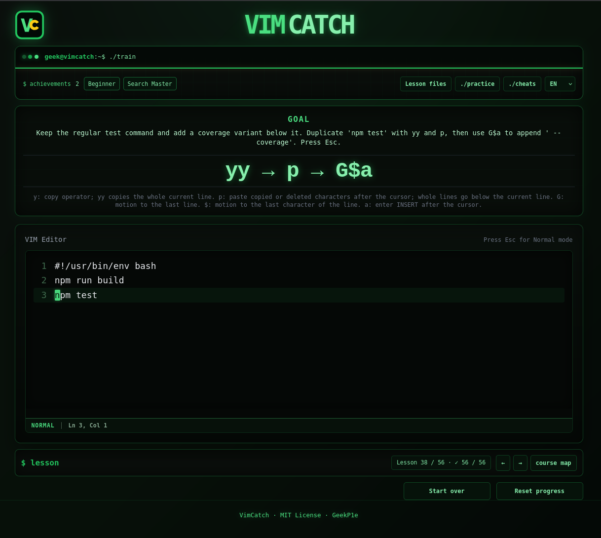
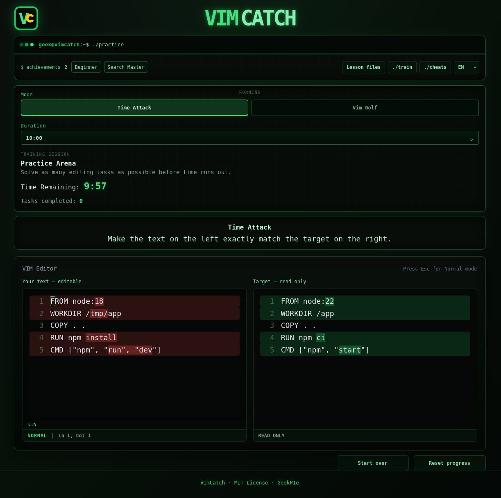
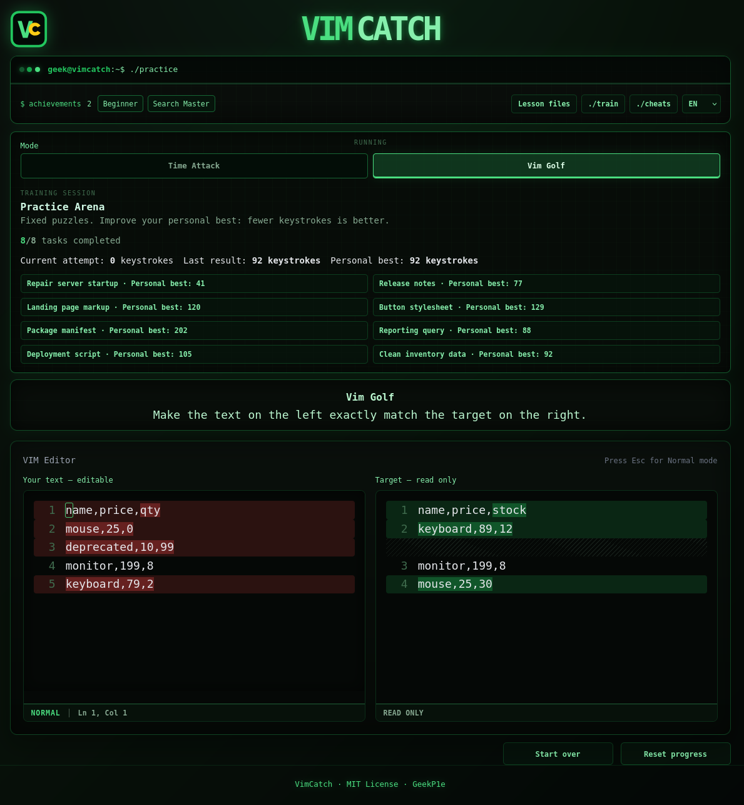
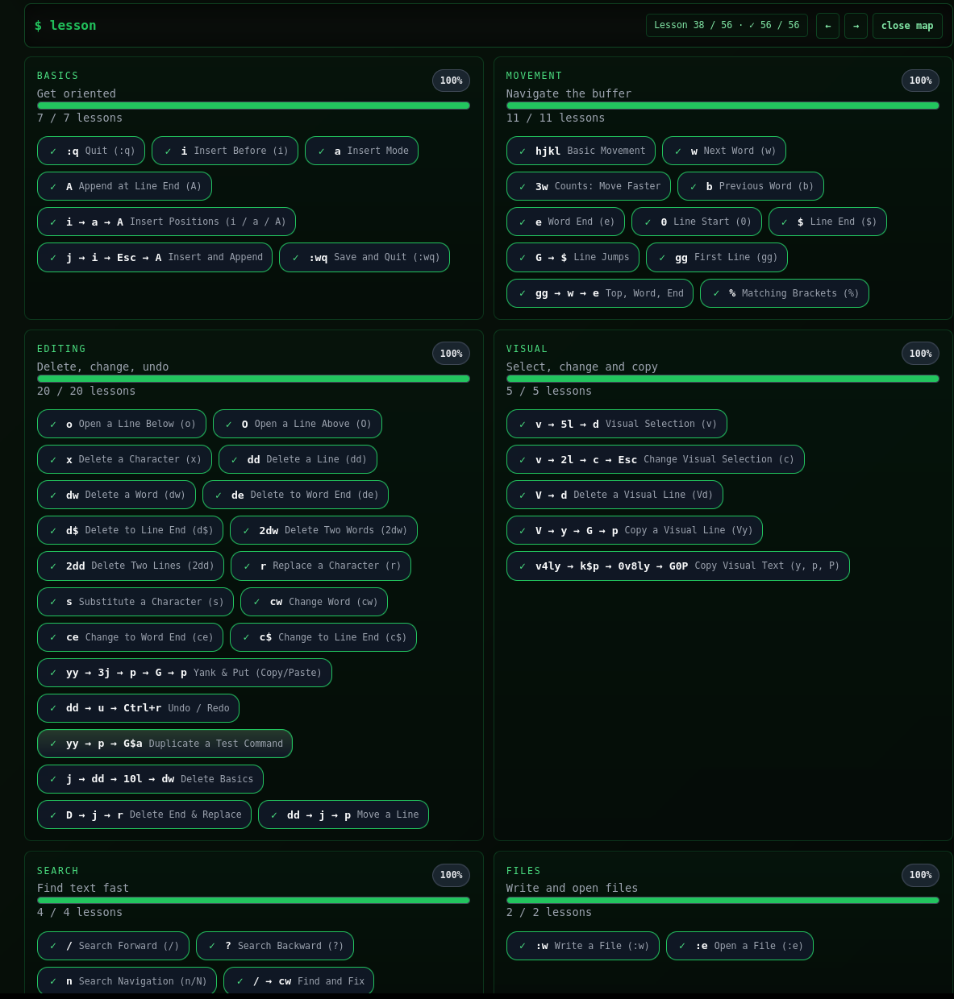
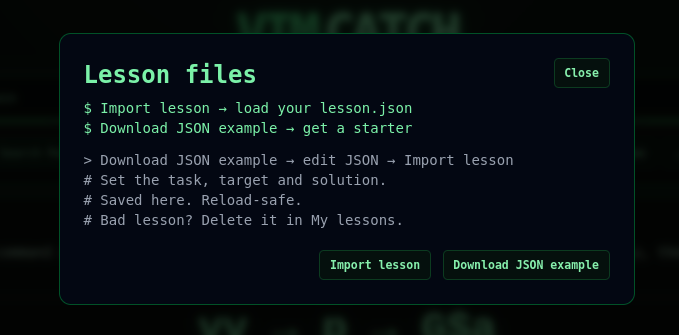
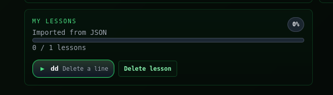

# VimCatch

Interactive terminal-style Vim training in the browser. VimCatch combines a
simulated editor, 56 progressive lessons, timed practice and a compact command
reference.

**56 lessons · Time Attack · Vim Golf · Import your own lessons**



## About this project

VimCatch is a modified version of [VIM Master](https://github.com/renzorlive/vimmaster),
originally created by [RNZ / renzorlive](https://github.com/renzorlive).

**Thank you, RNZ, for the idea of learning Vim through short, interactive
challenges, and for building the original game.** Your work provided the
inspiration and foundation for VimCatch. Publishing VIM Master under the MIT
License made it possible to build on that idea and share this edition with
others.

This edition is maintained by **GeekP1e**. Compared with the original project,
it includes:

- a redesigned, developer-oriented terminal interface;
- a more compact layout with blocks that were unnecessary for this edition removed;
- many additional Vim commands, lessons and generated drills;
- expanded validation and regression coverage for the training content.

Every added lesson has been completed manually by the maintainer. Its declared
solution is also executed automatically by the contract and golden test suites.

## Features

- Interactive Normal and Insert mode exercises
- 56 lessons across movement, editing, Visual mode, search, files, macros and advanced commands
- Timed Practice Arena
- Searchable command reference
- Local progress, XP, combos and achievements
- JSON-driven lesson content with automatic validation

## Screenshots

### Practice Arena

Work toward the target text shown beside your editor. Race the timer in
**Time Attack**, or find a shorter solution and improve your personal best in
**Vim Golf**.

| Time Attack | Vim Golf |
| :---: | :---: |
| <a href="images/screenshots/time-attack.png"></a> | <a href="images/screenshots/vim-golf.png"></a> |

### Course map

Choose any lesson, revisit a command and track progress across the course.

<details>
<summary><strong>View the course map</strong></summary>



</details>

### Your own lessons

Download a JSON example, define a task and import it. Imported lessons appear
in **My lessons**, stay saved across reloads and can be deleted individually.

| Lesson files | My lessons |
| :---: | :---: |
| <a href="images/screenshots/lesson-files.png"></a> | <a href="images/screenshots/custom-lessons.png"></a> |

## Quick start

```bash
npm ci
npm run check
npm start
```

The local server runs at `http://localhost:5180/`. Node.js 22.12 or newer is
required.

## Content

Lessons live in `content/lessons/`. Each lesson defines its initial buffer,
objective and a verified solution. The build bundles 56 regular lessons; Practice
Arena drills are generated at runtime from compatible lessons and task blueprints.
Eight mixed-command lessons combine navigation, search, editing and macros in
distinct tasks rather than repeating the same drills.
Focused tasks introduce i, a, o, O, x, dd, dw and r before combined edits.
The course progresses from navigation and individual edits to mixed tasks,
search, files, text objects and macros.

Vim Tutor commands also have dedicated tasks for b, e, A, de, d$, ce, c$,
2dw, 2dd and matching brackets (%). The simulator is not a complete Vim:
Visual mode has a separate block with five tasks: v, V, d, c and characterwise/linewise y, p and P.
R, U, blockwise Visual mode, substitution (:s), file reading (:r), shell commands,
search options and interactive help are not implemented yet.

To copy `89,12` from `mouse,89,12` into `keyboard,` on the line immediately
above, place the cursor on `8` and press `v4lyk$p`: `v4l` selects the five
characters, `y` copies, `k$` moves to the destination comma, and `p`
pastes after it. `P` pastes before the cursor. With whole-line copying
(`V` then `y`, or `yy`), `p` inserts below the current line and `P` above it.
The “Copy Visual Text (y, p, P)” lesson practises both characterwise puts.
The register keeps line breaks for multiline selections; counts, undo/redo
and dot repeat also work for puts. These operations follow
[Vim's copying and moving commands](https://vimhelp.org/change.txt.html#copy-move).

Useful commands:

```bash
npm run build:content
npm run test:contract
npm run test:golden
npm test
```

## Support VimCatch

If VimCatch helped you, you can [buy me a coffee on Boosty](https://boosty.to/geekpie)
☕ Your support helps me keep developing this free, open-source project.

Если VimCatch пригодился, можно [угостить меня кофе на Boosty](https://boosty.to/geekpie)
☕ Спасибо за поддержку разработки!

## Contributing

See [CONTRIBUTING.md](CONTRIBUTING.md) for setup and contribution guidelines.

Contributions are welcome. Fork VimCatch, add or improve lessons, run the full
validation suite, and open a pull request.

To add a lesson:

1. Create a JSON file in `content/lessons/` using an existing lesson as a template.
2. Use a unique `lesson-*` ID and fill in your name or alias in `author`.
3. Define a short objective, initial buffer, expected result and verified solution.
4. Run `npm run check` and make sure every suite passes.
5. Commit the lesson and open a pull request describing the command it teaches.

Keep lessons focused on one concept and short enough to complete without losing
the context of the command being practised. Improvements to the interface,
engine, tests and documentation are also welcome.

## Project structure

```text
content/     lesson definitions and schema
css/         application styles
images/      app icon and README screenshots
js/main.js   application entry point
js/core/     Vim commands and game state
js/lessons/  lesson loading, import, objectives and generated content
js/practice/ timed practice and golf tasks
js/ui/       rendering, reference and interface event handlers
js/storage/  progress and session persistence
js/utils/    logging, translations and shared helpers
scripts/     content build tools
tests/       contract, golden and regression tests
```

## License

VimCatch is distributed under the MIT License. The original RNZ copyright
notice and license terms are retained in `LICENSE`. Modifications to this
edition are copyright 2026 GeekP1e.
